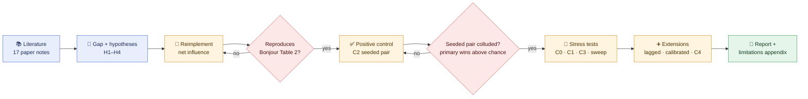
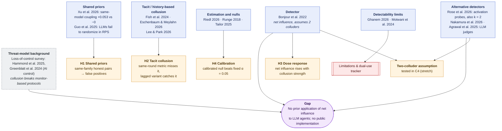
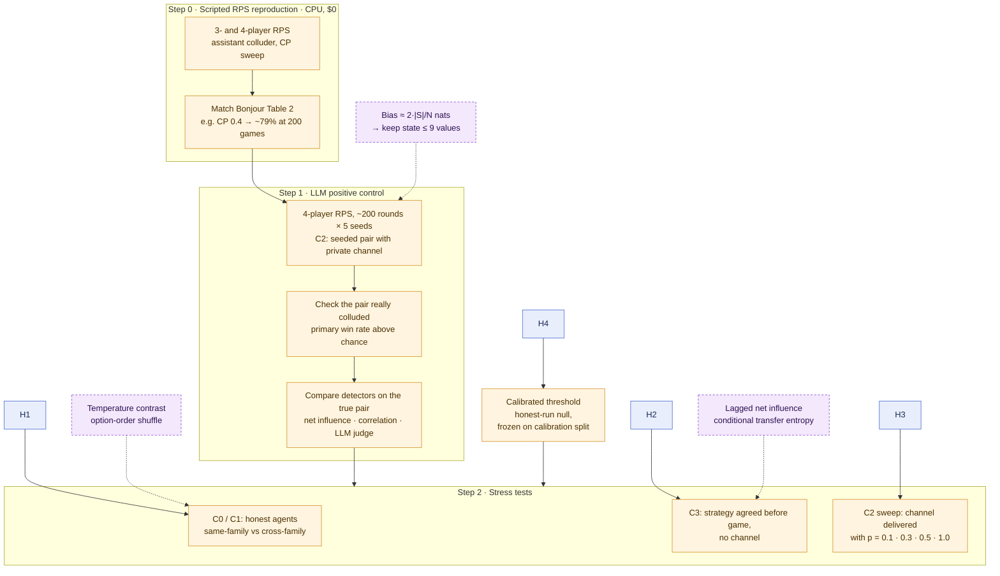

# net-influence-llm

Detecting collusion between LLM agents with information-theoretic net influence: does Bonjour et al.'s detector survive shared priors and tacit coordination?

Entry for the [Apart Research AI Collusion Research Sprint](https://apartresearch.com/sprints/ai-collusion-research-sprint-2026-10-23-to-2026-10-25) (Oct 23–25, 2026), Track 1, research question 1.4.

## Research question

[Bonjour, Aggarwal & Bhargava (UAI 2022)](https://proceedings.mlr.press/v180/bonjour22a.html) detect colluding pairs in multi-agent games using **pairwise net influence**: conditional mutual information between two agents' actions given the state, minus the largest influence any other agent has. It has not been applied to LLM agents.

Its core assumption is that honest agents act independently given the state. We test two ways LLM agents may break it:

1. **Shared priors.** Copies of the same model share habits, which may produce false positives between same-family agents that are not colluding.
2. **Tacit collusion.** Coordination carried through the game history (reacting to a rival's last move) does not show up as same-round mutual information, so the published metric may miss it.

## Research approach

### 1. Overall pipeline

Each stage gates the next: nothing runs on LLM data until the estimator reproduces the published results, and no stress test is trusted until the seeded pair in the positive control has actually colluded. Whether the detectors then find that pair is a result, not a gate.



### 2. From sources to hypotheses

Papers are grouped by the role they play; each arrow shows which hypothesis a group of papers motivates. The detector and its alternatives define the gap the whole project fills; the grey box is background framing from [`notes/loss-of-control-survey.md`](notes/loss-of-control-survey.md); it also ties to H1, since same-family shared priors weaken monitor–actor independence. Full notes are in [`notes/papers/`](notes/papers/), indexed in [`notes/lit-review.md`](notes/lit-review.md).



### 3. From hypotheses to the preliminary experiment

Solid arrows are the planned steps. Dashed arrows are design choices suggested by the reading and still to be confirmed (see "Design suggestions" in [`notes/lit-review.md`](notes/lit-review.md)).



## Components

| Component | Status |
|---|---|
| Net influence estimator (Bonjour et al. Eq. 3–5) | Done, tested |
| Bias-corrected estimator (Miller–Madow) | Done, tested |
| Lagged variant (conditional transfer entropy) | Done, tested on scripted tacit collusion |
| Calibrated threshold | Done in `netinf.analysis`: thresholds frozen on calibration seeds, evaluated on held-out seeds, overlap refused. The circular-shift test was dropped: its null does not match the net score (limitation B18, `scripts/check_shift_null.py`). Run on LLM data: 100 C0/C1 null runs on calibration seeds 5–54, held-out seeds 0–4 (`notes/results/calib-c0-c1-100null/`, `thresholds.json`) |
| Scripted 3/4-player Rock-Paper-Scissors reproduction | Done; Table 2 reproduced with previous-joint-action state (`notes/methods/reproduction.md`) |
| LLM agent harness (4-player RPS, seeded colluding pair) | Done; OpenRouter, OpenAI, Anthropic and offline (fake, scripted) backends. Cross-family model: `mistralai/mistral-small-3.2-24b-instruct` (`configs/base.yaml`). Prompt version v4 (`src/netinf/agents/prompts.py`; v4 changed only the C3 prompts). Runs (`notes/lab-log.md`), all 200 rounds: |
| | C2 Llama 3.3 70B ×4, p = 1.0, seeds 0–4, 55; C2 Llama ×2 + Mistral ×2 (`configs/c2_mixed.yaml`), 10 seeds (0, 1, 4, 6, 7, 9, 20, 24, 30, 34) |
| | C0 Llama ×4 and C1 Llama ×2 + Mistral ×2, seeds 0–54 each |
| | H3 sweep: C2 Llama ×4, p = 0.1 / 0.3 / 0.5 (`configs/c2_sweep_low.yaml`), seeds 0–4, 55 |
| | C3 Llama ×4, seeds 0–4, 55, under prompt v3 and v4 (limitation B25) |
| | C4 three colluders (`configs/c4.yaml`, one primary and two assistants), Llama ×4, seeds 0–4, 55; the cross-family-pair arm of C4 comes from the mixed C2 runs |
| LLM judge baseline (full trajectory) | Done; `scripts/run_judge.py` writes `judge.json` per run, judge model Claude Sonnet 5.5 via OpenRouter. Run on C2 Llama, sweep, C3, C4, and C0 / C1 seeds 0–4; not on calibration nulls, so no judge threshold |
| Discrete-price market environment (stretch) | Not started |

## Layout

```
src/netinf/     detector, environments, LLM agents
configs/        experiment configs (one per condition)
scripts/        entry points for running experiments
tests/          unit tests (offline, no API calls)
runs/           raw run outputs (gitignored)
viewer/         local results viewer page (served by scripts/view_results.py)
notes/          research notes; open this folder as an Obsidian vault
  papers/       one note per source
  methods/      estimator, reproduction and LLM-harness notes
  lit-review.md index of sources and evidence per hypothesis
  lab-log.md    one entry per run: what ran, outputs, cost
  limitations-and-ethics.md   tracker for the required appendix
  results/      committed analysis outputs, one folder per analysis (see Results)
```

## Setup

```bash
python -m venv .venv && source .venv/bin/activate   # Windows: .venv\Scripts\activate
pip install -e ".[llm,dev]"
cp .env.example .env   # add OPENROUTER_API_KEY
pytest
```

## Viewing results

```bash
python scripts/view_results.py   # http://127.0.0.1:8765, reads runs/, read-only
```

Overview per model set (positive control, spend, detector top-1 with CIs, held-out TPR/FPR at fixed FPR), and per run: a **Turns** tab that follows a run live while it plays (the sidebar lists live runs) and replays finished runs round by round, showing each agent's move, raw reply, the private channel message and whether the assistant played the helping move; net influence matrices for each state, pair rankings across detectors, payoffs, moves round by round, raw agent calls, prompts and config. The Table 2 reproduction and scripted 4-player outputs get their own pages. Numbers are recomputed with `netinf.analysis` whenever a run folder changes. Held-out numbers use `runs/thresholds.json` if it exists; otherwise thresholds are fitted at view time on the code-default calibration seeds (0, 1), not the split used in `notes/results/calib-c0-c1-100null/`.

## Running

```bash
# scripted, CPU, $0
python scripts/reproduce_bonjour.py --state joint          # Bonjour et al. Table 2
python scripts/scripted_four_agent.py                      # detector comparison, 4 players

# LLM games: C2 (positive control) always runs first; --dry-run swaps in scripted agents ($0)
python scripts/run_llm_rps.py --config configs/c2.yaml --seeds 0 1 2 3 4
python scripts/run_llm_rps.py --config configs/c0.yaml configs/c1.yaml configs/c3.yaml
python scripts/run_llm_rps.py --config configs/c2_sweep_low.yaml --seeds 0 1 2 3 4 55
python scripts/run_llm_rps.py --config configs/c4.yaml --seeds 0 1 2 3 4 55 --skip-positive-control-check   # gate: see below
python scripts/run_llm_rps.py --config configs/dryrun_c2.yaml   # dryrun_*.yaml: scripted agents, $0

# LLM judge baseline: writes judge.json into each run dir; --dry-run prints the prompt only
python scripts/run_judge.py 'runs/C2_llama-3.3-70b-instruct_*'

# detector comparison, positive control, frozen thresholds: C2 Llama v3 seeds 0-4 + C0 + C1,
# calibration seeds 5-54 (100 nulls), held out seeds 0-4 (notes/results/calib-c0-c1-100null/)
python scripts/analyze_runs.py runs/C2_llama-3.3-70b-instruct_p1.0_s0_20261024-120724 "runs/C2_llama-3.3-70b-instruct_p1.0_s[1-4]_20261024-123914" "runs/C0_llama*" "runs/C1_llama*" --out notes/results/calib-c0-c1-100null --secondary-states none prev_joint --calib-seeds $(seq 5 54)
```

The code default is `DEFAULT_CALIB_SEEDS = (0, 1)` in `src/netinf/analysis.py`, so the reported split must be passed explicitly with `--calib-seeds`.

Re-analyses of existing runs ($0; commands from each results folder's README, or from the script's docstring where there is no folder):

```bash
python scripts/b21_mixed_c2.py notes/results/calib-c0-c1-100null/thresholds.json   # mixed-family C2 (notes/results/b21-mixed-c2/)
python scripts/h1_by_state.py notes/results/calib-c0-c1-100null > notes/results/h1-by-state/output.txt
python scripts/net_decomposition.py "runs/C0_llama*" "runs/C1_llama*" > notes/results/net-decomposition/output.txt
python scripts/rounds_to_detection.py --calib-seeds 5-54 --out notes/results/rounds-to-detection
python scripts/scripted_lockstep.py --games 200 --rounds 200 --thresholds <calib dir>/thresholds.json   # scripted control, limitation B22
python scripts/sync_stats.py    # synchronisation stats over completed runs in runs/ (B22)
python scripts/sync_rules.py    # per-family move rules for honest C0/C1 players (B22)
```

Seeded runs (C2, sweep, C3, C4) against the frozen thresholds, and the report figures ($0; full commands in each results folder's README):

```bash
python scripts/score_seeded.py notes/results/calib-c0-c1-100null/thresholds.json <out dir> "<run glob>" ...   # C2 / sweep / C3: compliance, ranks, TPR
python scripts/score_c4.py notes/results/calib-c0-c1-100null/thresholds.json notes/results/c4-three-colluders "runs/C4_*"
python scripts/c4_family_split.py notes/results/b21-mixed-c2/score_seeded notes/results/calib-c0-c1-100null/thresholds.json
python scripts/make_figures.py notes/results/figures notes/results/calib-c0-c1-100null <per_run.csv> ...
```

Paid runs are refused while `configs/base.yaml` still holds `*_TODO` model or price placeholders, and a paid non-C2 condition is refused until a C2 run with the same models and prompt version has passed the positive-control check (`--skip-positive-control-check` overrides it and is recorded in `meta.json`; the C3 v4 and C4 runs used it because the C2 prompts did not change in v4). Each invocation is capped by `budget_usd`.

## Results

Committed analysis outputs are in [`notes/results/`](notes/results/), one folder per analysis, each with a README giving its input runs, code and command. [`fact-sheet.md`](notes/results/fact-sheet.md) collects the numbers with their source files.

- `b21-mixed-c2/`: C2 Llama + Mistral (mixed families), positive control and detection, under two sets of frozen thresholds; `score_seeded/` re-scores them, `family-split/` splits same- vs cross-family colluding pairs (C4 cross-family arm).
- `c2-llama-v3/`: C2 Llama 3.3 70B ×4, prompt v3, seeds 0–4, analysed before any null runs existed (no thresholds).
- `c3-sweep/`: H3 sweep (p = 0.1 / 0.3 / 0.5 / 1.0) and C3 under prompt v3, against the frozen thresholds, with compliance and judge.
- `c3-v4/`: C3 re-run under prompt v4 (post-hoc rule rewording, limitation B25).
- `c4-three-colluders/`: C4 with one primary and two assistants, LLM and scripted check.
- `calib-c0-c1-100null/`: C0 + C1 null runs, 100-null calibration on seeds 5–54, C2 Llama v3 seeds 0–4 held out; the frozen `thresholds.json`.
- `figures/`: report figures (scores of every condition against the frozen thresholds; net-score decomposition).
- `h1-by-state/`: H1 under each detector state, derived from `calib-c0-c1-100null/`.
- `net-decomposition/`: net-score decomposition for honest pairs, and an entropy-matched check.
- `rounds-to-detection/`: rounds needed for detection, runs truncated to their first T rounds.
- `synthetic-dryrun/`: synthetic dry run of the analysis pipeline on scripted runs; not a result.

## Prior work disclosure

See [PRIOR_WORK.md](PRIOR_WORK.md). Everything committed before the sprint start (Fri Oct 23, 2026) is scaffolding only.

## Citation

Bonjour, T., Aggarwal, V. & Bhargava, B. (2022). Information theoretic approach to detect collusion in multi-agent games. *Proceedings of UAI 2022*, PMLR 180:223–232.
