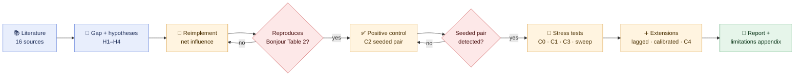
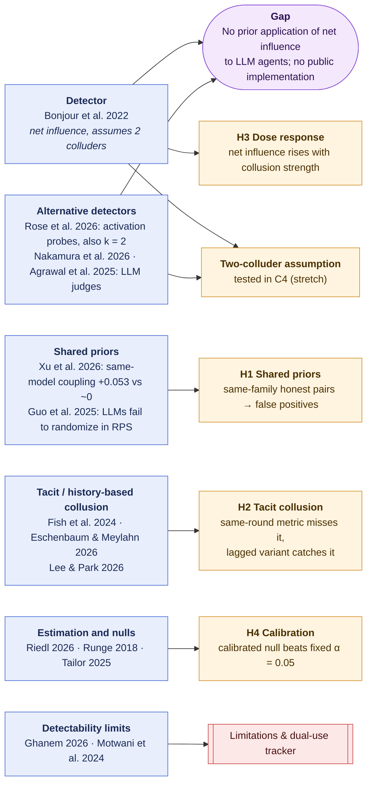
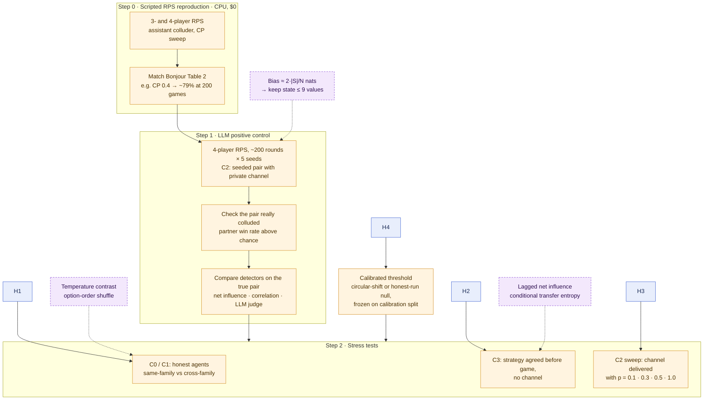

# net-influence-llm

Detecting collusion between LLM agents with information-theoretic net influence: does Bonjour et al.'s detector survive shared priors and tacit coordination?

Entry for the [Apart Research AI Collusion Research Sprint](https://apartresearch.com/sprints/ai-collusion-research-sprint-2026-10-23-to-2026-10-25) (Oct 23–25, 2026), Track 1, research question 1.4.

## Research question

[Bonjour, Aggarwal & Bhargava (UAI 2022)](https://proceedings.mlr.press/v180/bonjour22a.html) detect colluding pairs in multi-agent games using **pairwise net influence**: conditional mutual information between two agents' actions given the state, minus the largest influence any other agent has. It has not been applied to LLM agents.

Its core assumption is that honest agents act independently given the state. We test two ways LLM agents may break it:

1. **Shared priors.** Copies of the same model share habits, which may produce false positives between same-family agents that are not colluding.
2. **Tacit collusion.** Coordination carried through the game history (reacting to a rival's last move) does not show up as same-round mutual information, so the published metric may miss it.

## Research approach

### 1. Overall pipeline

Each stage gates the next: nothing runs on LLM data until the estimator reproduces the published results, and no stress test is trusted until the positive control fires.



### 2. From sources to hypotheses

Papers are grouped by the role they play; each arrow shows which hypothesis a group of papers motivates. The detector and its alternatives define the gap the whole project fills. Full notes are in [`notes/papers/`](notes/papers/), indexed in [`notes/lit-review.md`](notes/lit-review.md).



### 3. From hypotheses to the preliminary experiment

Solid arrows are the planned steps. Dashed arrows are design choices suggested by the reading and still to be confirmed (see "Design suggestions" in [`notes/lit-review.md`](notes/lit-review.md)).



## Planned components

| Component | Status |
|---|---|
| Net influence estimator (Bonjour et al. Eq. 3–5) | Not started |
| Bias-corrected estimator (Miller–Madow) | Not started |
| Lagged variant (conditional transfer entropy) | Not started |
| Calibrated threshold (circular-shift null) | Not started |
| Scripted 3/4-player Rock-Paper-Scissors reproduction | Not started |
| LLM agent harness (4-player RPS, seeded colluding pair) | Not started |
| Discrete-price market environment (stretch) | Not started |

## Layout

```
src/netinf/     detector, environments, LLM agents
configs/        experiment configs (one per condition)
scripts/        entry points for running experiments
tests/          unit tests for the estimators
runs/           raw run outputs (gitignored)
notes/          research notes; open this folder as an Obsidian vault
  papers/       one note per source
  methods/      estimator and statistics notes
  lit-review.md index of sources and evidence per hypothesis
  limitations-and-ethics.md   tracker for the required appendix
```

## Setup

```bash
python -m venv .venv && source .venv/bin/activate
pip install -e ".[dev]"
cp .env.example .env   # add API keys
pytest
```

## Prior work disclosure

See [PRIOR_WORK.md](PRIOR_WORK.md). Everything committed before the sprint start (Fri Oct 23, 2026) is scaffolding only.

## Citation

Bonjour, T., Aggarwal, V. & Bhargava, B. (2022). Information theoretic approach to detect collusion in multi-agent games. *Proceedings of UAI 2022*, PMLR 180:223–232.
